This page is the mathematical model of the case: objective, specifications, geometry, derivation, conditions, domain and explorer. The idea is told on the entry page, and the case is read through, with its numbers, on the technical page.

Writing rules: every geometric quantity and every force is shown in a figure before it enters a formula; stiffnesses, masses and limits are defined in the quantities table. Equations are numbered in order of appearance and cited as eq. (N); a bare number always denotes an element of the patent, written with its name ("limb tip 28"). Units are SI, with the units archers use (pounds, inches, grains, feet per second) in brackets where they help.

## 1. Objective

A bow stores in its limbs the work the archer does in drawing the string, and gives it back to the arrow when the string is released. The archer must also hold the string at full draw while aiming. The draw length is fixed by the archer's body, so a bow can store more energy only by drawing harder; and the force the archer must hold at full draw, in a bow whose force grows along the whole draw, is the largest of the draw. The device must store as much energy as possible for a given peak force and draw length, and let the archer hold less than the peak while aiming.

The reference case is the condition under which manufacturers rate the speed of compound bows (ATA speed rating): peak draw force 70 lb (311 N), draw length 30 in (762 mm), arrow of 350 grains (22.68 g). The draw length is defined by the standard as the distance from the nocking point to the pivot point of the grip plus 1.75 in; the nocking point at full draw is therefore 717.55 mm from the pivot point. The brace height (pivot point to string, bow strung and not drawn) is assumed to be 177.8 mm (7 in), so the power stroke, from brace to full draw, is 539.75 mm (21.25 in).

## 2. Specifications

**S1 — Peak draw force.** The draw force must not exceed 311 N (70 lb) anywhere along the draw. It is the force the archer can produce; the peak is reached during the draw, not necessarily at its end. In the model S1 is used as a setting: the stiffness of the limbs is chosen so that the peak is exactly 311 N (§7.1), and both bows are compared at the same peak.

**S2 — Holding force.** At full draw the archer must hold at most half the peak force: let-off of at least 50 %, where let-off = 1 − holding force / peak force, the fraction of the peak the archer is spared while aiming. The value is assumed; it states the purpose of the device (aiming with a force well below the peak). The critical case is an archer whose draw length differs from the one the bow is set for, because the bow is then held away from the point of lowest force.

**S3 — Stored energy.** The bow must store more energy than a bow with the string tied to the limb tips, with the same peak force and the same draw. This is the gain the patent claims; it is what sends the arrow faster.

**S4 — The bow returns the string.** At full draw the draw force must stay positive: released, the string moves towards the target.

No design check on strength is set: the model does not size limbs, string or cables. The tensions they carry are given in §6 and discussed in §10.

## 3. Elements and patent references

Element names are fixed here and used unchanged in the documents, figures and explorer. Reference numbers are those of US 3,486,495; they allow the reader to follow the mechanism on the patent drawings.

*Figure 1. The bow of US 3,486,495, figure 1 of the patent (source: US 3,486,495, H. W. Allen, filed 1966), strung and at rest. Handle section 22 with limbs 24 and 26; eccentric pulleys 32 and 38 on the cross pins 30 and 36 at the limb tips 28 and 34; the bowstring 40, with the central stretch 42 and the end stretches 44 and 46 crossing to the opposite limb tips.*

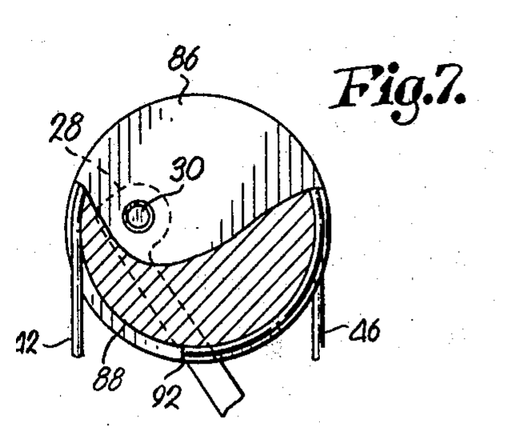

*Figure 2. The circular eccentric pulley 86, figure 7 of the patent (source: US 3,486,495): two circular tracks 88 and 90 of equal length, the cross pin 30 off the centre, the crossover notch 92 between the tracks; central stretch 42 and end stretch 46 leaving the pulley. This is the pulley of the model.*

| Element | Patent reference | Note |
|---|---|---|
| riser | handle section 22 | rigid in the model |
| limb (upper, lower) | limbs 24, 26 | a rigid arm on an elastic hinge (§5) |
| limb tip | 28, 34 | carries the axle |
| axle | cross pins 30, 36 | the axis of rotation of the pulley |
| eccentric pulley | members 32, 38 (oval tracks, patent figures 3–6); member 86 (circular tracks, patent figures 7–8) | the model uses the circular pulley 86 |
| string and cable tracks | 80, 82 (oval); 88, 90 (circular) | string track and cable track |
| crossover notch | 84 (oval); 92 (circular) | the string passes from one track to the other; it fixes the string to the pulley, so it cannot slip |
| string | central stretch 42 of the bowstring 40 | from pulley to pulley through the nocking point |
| cable | end stretches 44, 46 | from each pulley to the axle of the opposite limb |
| cable anchor | adjustable couplings 48, 52 | the cable is fastened at the opposite axle |
| nocking point | 58 (on the serving 56) | where the arrow sits and the archer pulls |
| arrow shelf | 23 | not in the model |
| limb pivots and adjustment knobs | pivot pins 62, 76; knobs 70, 78 | set the pull weight and relax the limbs; held fixed while shooting, excluded |

Elements without reference: the **hinge** of each limb is a model element (§5): the patent limbs flex along their length. The **pivot point of the grip** (the deepest point of the grip, where the hand pushes) is the reference of the standard for draw length and brace height. The comparison bow, a **bow with the string tied to the limb tips**, is not in the patent drawings; the patent describes it as the conventional bow (its "lines 104 and 106" in figure 9). The model represents it with the same limbs and the string fastened at the axle.

## 4. How it works

### 4.1 The path of the bowstring

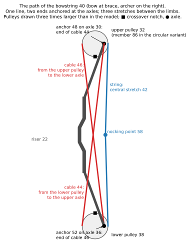

*Figure 3. The path of the bowstring 40, bow at brace, archer on the right. The pulleys are drawn three times larger than in the model. ■ crossover notch, ● axle.*

The bowstring 40 is one line with two ends, both anchored at the axles. From the upper axle (cross pin 30, where the end stretch 44 is fastened by the coupling 48), the end stretch 44 runs down to the lower pulley 38; there it passes from one track to the other through the crossover notch and leaves the pulley, on the side of the archer, as the central stretch 42. The central stretch runs up through the nocking point 58 to the upper pulley 32, passes through its notch onto the other track and leaves, on the side of the target, as the end stretch 46, which runs down to the lower axle (cross pin 36, coupling 52). Three stretches are stretched between the limbs: the central stretch on the side of the archer and the two end stretches crossing each other.

### 4.2 String and cable

The string and the cable are stretches of the same bowstring 40; the names describe what they do. The **string** (central stretch 42) runs from pulley to pulley through the nocking point: it is the only stretch the archer pulls and the only one that pushes the arrow. The **cable** (end stretches 44, 46) runs from each pulley to the axle of the opposite limb: it touches neither the archer nor the arrow.

**While the archer draws the bow,** the string unwinds from its track and turns the pulley; the same rotation winds the cable onto the other track, and the cable pulls the two limb tips towards each other, bending the limbs. The tension of the string gives the draw force; the tension of the cable carries the load of the limbs. For a small rotation, the lengths of string unwound and cable wound are in the ratio of their lever arms about the axle, and the tensions in the inverse ratio (§6.3).

**When the archer releases the string,** everything runs backwards: the limbs pull the cables, which unwind and turn the pulleys the other way; the pulleys wind the string back onto its tracks, and the string, shortening, pushes the arrow.

### 4.3 The pulley during the draw

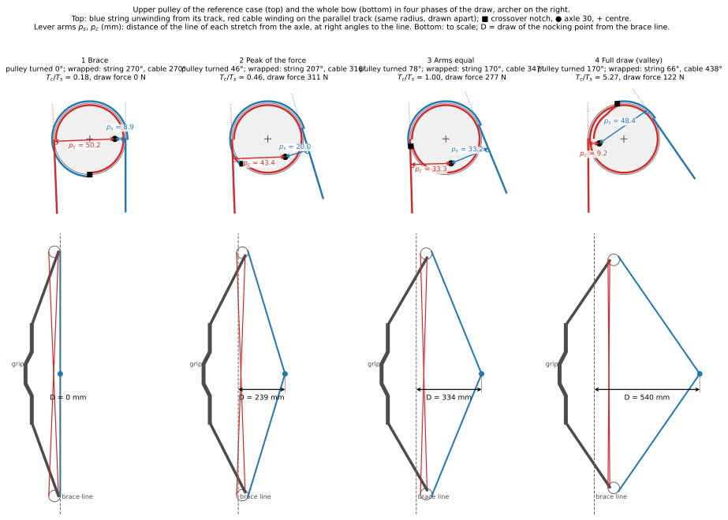

*Figure 4. Top: the upper pulley of the reference case seen from the side, archer on the right, in four phases of the draw; ● axle (cross pin 30, fixed to the limb tip), + centre of the pulley, ■ crossover notch 92; blue: string, leaving towards the nocking point; red: cable, leaving towards the lower axle; the lever arms $p_s$ and $p_c$ are dimensioned in mm. Bottom: the whole bow in the same phase, to scale, with the draw $D$ of the nocking point from the brace line.*

The axle is off the centre of the pulley. String and cable leave the pulley on opposite sides of the axle, so the offset that shortens the arm of one lengthens the arm of the other. As the pulley turns, the axle passes from the side of the string to the side of the cable, and the two arms exchange:

| phase | draw from brace | pulley turned | arm of the string $p_s$ | arm of the cable $p_c$ | $T_c/T_s$ | draw force |
|---|---|---|---|---|---|---|
| 1 brace | 0 mm | 0° | 8.9 mm | 50.2 mm | 0.18 | 0 N |
| 2 peak of the force | 239 mm | 46° | 20.0 mm | 43.4 mm | 0.46 | 311 N |
| 3 arms equal | 334 mm | 78° | 33.2 mm | 33.3 mm | 1.00 | 277 N |
| 4 full draw | 540 mm | 170° | 48.4 mm | 9.2 mm | 5.27 | 122 N |

Early in the draw the cable winds on the long arm: each millimetre of string bends the limbs a lot, and the force rises. Late in the draw the cable works on the short arm and the string on the long one: the load of the limbs reaches the archer reduced, and the force falls.

### 4.4 The two tracks

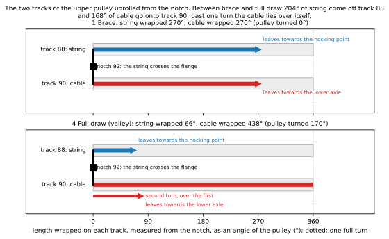

*Figure 5. The two tracks of the upper pulley unrolled from the crossover notch, at brace and at full draw: the length wrapped on each track, as an angle of the pulley.*

The two tracks 88 and 90 have the same radius and lie side by side, separated by a flange (patent figure 8). At the notch 92 the bowstring crosses the flange from one track to the other. It cannot slip along the tracks: it is bent through the notch and pulled from both sides, so the crossover is always the same point of the bowstring, and it turns with the pulley. At brace the string is wrapped 270° on track 88 and the cable 270° on track 90: one turn and a half in all, as in the patent. The 270° are a convention of the model: counted from the point where the string leaves the pulley, the notch is straight below the centre; counted from the point where the cable leaves, it is 2.3° further round. The difference is constant: it enters only the wrapped angles quoted here, not the lengths of eq. (5) and (6), which count the change from brace.

At full draw the string is wrapped 66° and the cable 438°: 204° of string have come off track 88 and 168° of cable have gone onto track 90. The pulley itself has turned 169.5°; the two counts differ from it because the points where string and cable leave the pulley move as it turns. The leaving point of the string climbs 34.7° along the rim (the angle $\theta_s$ of figure 8), so 169.5° + 34.7° = 204° of string come off; the leaving point of the cable moves 1.8° the other way, so 169.5° − 1.8° = 168° of cable go on. In all, string and cable are wrapped 503.5° at full draw instead of 540° at brace. Past one turn the cable lies over itself (§10).

### 4.5 The bow during the draw

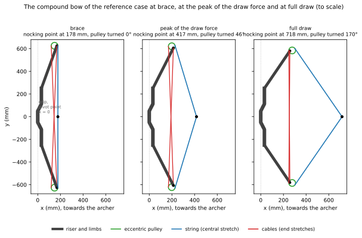

*Figure 6. The bow of the reference case at brace, at the peak of the draw force and at full draw, drawn to scale from the model. The pulley turns 170° between brace and full draw.*

**Brace.** The string is straight. On each pulley the axle is off the centre towards the archer, so the string leaves the pulley close to the axle and the cable far from it.

**First part of the draw.** Pulling the nocking point unwinds the string from the pulley and turns it. Because the string leaves close to the axle and the cable far from it, a small length of string unwound winds a large length of cable: the cables shorten fast, the limb tips are pulled towards each other and the limbs bend fast. The draw force rises steeply.

**Peak.** The limbs are bent further and pull harder, but each millimetre of draw now bends them less, because the axle is moving round the pulley. The draw force depends on both; it reaches its peak after 239 mm of draw, with the pulley turned 46°.

**Second part of the draw.** The axle has moved to the side of the target: the string now leaves the pulley far from the axle and the cable close to it. A large length of string unwound winds a small length of cable; the limbs bend slowly, and the force needed to go on decreases.

**Full draw.** The pulley has turned 170°, close to the position where the far side of the pulley points towards the archer, as the patent says. The draw force is at its lowest after the peak, the **valley**: the archer holds the **holding force**, less than the peak. The ratio of the two is the **let-off**: let-off = 1 − holding force / peak.

## 5. Geometry

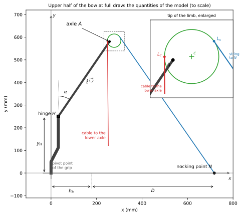

*Figure 7. Upper half of the bow at full draw, to scale, with the tip of the limb enlarged. Axes: origin at the pivot point of the grip, $x$ along the arrow towards the archer, $y$ upwards. Limb: arm $\vec\ell$, of length $\ell$, from the hinge $H$ (height $y_H$) to the axle $A$, at the angle $\alpha$ from the vertical, positive towards the archer; $\alpha$ grows as the limb bends. Nocking point $N$ on the $x$ axis; brace height $h_b$; draw from brace $D$. Enlarged: the axle $A$, the centre $c$ of the pulley and the points $L_s$, $L_c$ where string and cable leave it.*

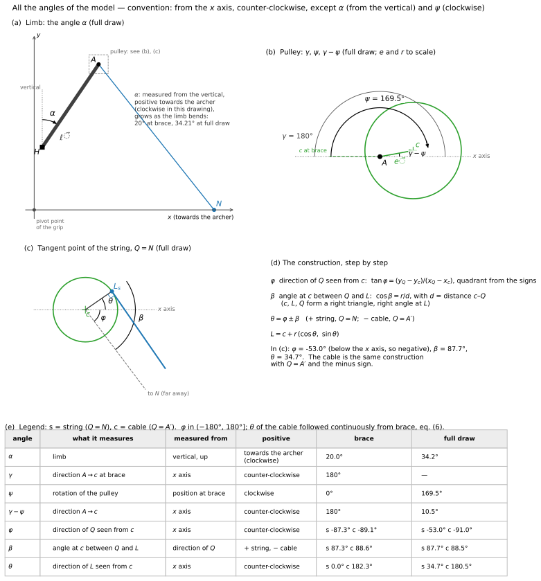

*Figure 8. All the angles of the model. (a) The angle $\alpha$ of the limb, from the vertical. (b) The pulley: the direction $\gamma$ of the centre at brace, the rotation $\psi$, the direction $\gamma - \psi$ of the offset at full draw. (c), (d) The construction of the tangent point of the string, eq. (3): $\varphi$, $\beta$, $\theta$. (e) Each angle with its origin, its positive sense and its values at brace and at full draw (s: string, c: cable).*

**Angles.** The angle $\alpha$ of the limb is measured from the vertical; all the other angles ($\gamma$, $\psi$, $\varphi$, $\theta$) are measured from the $x$ axis, counter-clockwise, except the rotation $\psi$ of the pulley, positive clockwise, and the angle $\beta$, measured from the direction $\varphi$ (figure 8).

**Notation.** Points are position vectors. An arrow marks a vector, with its length and direction: $\vec\ell$, $\vec e$, $\vec u_s$; $\overrightarrow{PQ} = Q - P$ is the vector from $P$ (tail) to $Q$ (head). Letters without arrow are scalars: lengths ($\ell$, $e$, $r$, $p$), components ($u_{s,x}$), tensions. A function is written with its argument attached, $c(\alpha,\psi)$; a product by a bracket carries a dot, $C\cdot(\alpha-\alpha_u)$. In the plane, $\vec a \times \vec b$ denotes the scalar $a_x b_y - a_y b_x$, the $z$ component of the cross product; positive counter-clockwise. Each equation is written in compact form and then in coordinates.

The bow is symmetric about the arrow, and the nocking point moves along the $x$ axis (Park 2009 measured its path on a compound bow within 1 mm of a straight line). The model follows the upper half; the lower half is its mirror image, $y \to -y$.

**Limb.** The limb is a rigid arm of length $\ell$ turning about a hinge $H$ at height $y_H$, with an elastic moment $C\cdot(\alpha - \alpha_u)$ resisting the rotation, where $C$ is the rotational stiffness of the hinge (N·m/rad, set in §7.1) and $\alpha_u$ the angle of the limb unstrung. This is Hickman's model of the bow, used by Park (2009) for a compound bow. The axle is at

$$\vec\ell = \ell\,(\sin\alpha,\ \cos\alpha), \qquad A(\alpha) = H + \vec\ell \tag{1}$$

that is, in coordinates,

$$x_A = x_H + \ell\sin\alpha, \qquad y_A = y_H + \ell\cos\alpha$$

valid for the arm model of the limb (the real limb bends along its length; §10). $\alpha$ is measured from the vertical, positive towards the archer; it grows as the limb bends, so the axle moves towards the archer and towards the arrow.

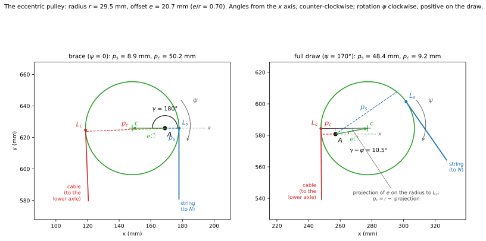

*Figure 9. The eccentric pulley at brace and at full draw. Radius $r$; $\vec e$: offset vector from the axle $A$ to the centre $c$, fixed to the pulley, of length $e$; its direction is the angle $\gamma - \psi$ from the $x$ axis: $\gamma$ = 180° at brace (centre towards the target), 10.5° at full draw. The pulley turns clockwise by $\psi$, positive on the draw. The string leaves the pulley at the tangent point $L_s$ towards the nocking point, the cable at $L_c$ towards the lower axle; $p_s$, $p_c$ (dashed): lever arms of string and cable about the axle $A$, the distance of $A$ from the line of each stretch; defined by eq. (4). At full draw, the projection of the offset on the radius to $L_c$ shortens the arm of the cable, eq. (4).*

**Pulley.** The centre of the pulley is

$$\vec e = e\,\big(\cos(\gamma-\psi),\ \sin(\gamma-\psi)\big), \qquad c(\alpha,\psi) = A(\alpha) + \vec e \tag{2}$$

that is, in coordinates,

$$x_c = x_A + e\cos(\gamma-\psi), \qquad y_c = y_A + e\sin(\gamma-\psi)$$

with $\psi$ the rotation of the pulley from brace, positive clockwise in figure 9. $\gamma - \psi$ is the angle of the segment from the axle to the centre, measured from the $x$ axis, counter-clockwise; at brace it is $\gamma$ = 180° (the centre towards the target, as the patent describes the position at rest), and it decreases as the pulley turns clockwise. The two tracks are circles of the same radius $r$ (patent figures 7–8); the model treats them as one circle in the plane of the drawing.

**Tangent points.** Two points of the pulley must be kept apart: the **centre** $c$ of the circle, which fixes where a stretch leaves the pulley, and the **axle** $A$, about which the pulley turns, which fixes the lever arm of the stretch.

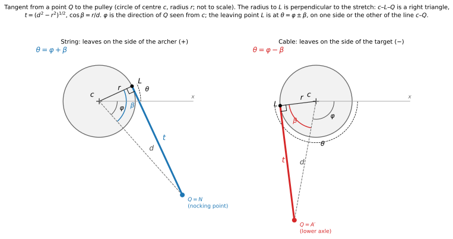

*Figure 10. A stretch from a point $Q$ to the pulley leaves it at the tangent point $L$; the radius to $L$ is perpendicular to the stretch, so centre, $L$ and $Q$ form a right triangle. Left: the string ($Q = N$), sign +; right: the cable ($Q = A'$), sign −. Not to scale.*

A stretch from a point $Q$ to the pulley touches the circle at the tangent point $L$, at the angle $\theta$ (measured from the $x$ axis) and has free length $t$:

$$d = |Q - c|,\qquad t = \sqrt{d^2 - r^2},\qquad \theta = \operatorname{atan2}(Q - c) \pm \arccos\frac{r}{d} \tag{3}$$

Step by step, in coordinates, for a stretch from a point $Q$ to the pulley:

1. the distance of $Q$ from the centre, $d = \sqrt{(x_Q - x_c)^2 + (y_Q - y_c)^2}$;
2. the free length, from the right triangle, $t = \sqrt{d^2 - r^2}$;
3. the direction of $Q$ seen from the centre, $\varphi$, with $\tan\varphi = (y_Q - y_c)/(x_Q - x_c)$ and the quadrant given by the signs of numerator and denominator (this is what $\operatorname{atan2}$ does);
4. the angle $\beta$ at the centre between that direction and $L$, with $\cos\beta = r/d$;
5. the angle of the tangent point, $\theta = \varphi \pm \beta$;
6. its coordinates, $x_L = x_c + r\cos\theta$, $y_L = y_c + r\sin\theta$.

The sign:

- plus for the string ($Q = N$): it leaves the pulley on the side of the archer, on one side of the line from the centre to $N$;
- minus for the cable ($Q = A'$, the lower axle, the mirror of $A$): it leaves on the side of the target, on the other side of the line from the centre to $A'$.

The angle $\theta$ is followed continuously along the draw; valid while $Q$ is outside the circle.

**Lever arm.** The lever arm of a stretch leaving the tangent point $L$ along the unit vector $\vec u$ is the distance of its line from the axle $A$:

$$p = \big|\overrightarrow{AL}\times\vec u\big| \tag{4}$$

$\overrightarrow{AL}\times\vec u$ is the component of $\overrightarrow{AL}$ perpendicular to $\vec u$, times $|\vec u| = 1$: the distance of $A$ from the line of the stretch. When $A$ lies on the radius to $L$ it is the length of $AL$; otherwise it is shorter (figure 11). In coordinates, with $\overrightarrow{AL} = (x_L - x_A,\ y_L - y_A)$, from the tail $A$ to the head $L$, and the direction of the stretch $u_x = (x_Q - x_L)/t$, $u_y = (y_Q - y_L)/t$:

$$\overrightarrow{AL}\times\vec u = AL_x\,u_y - AL_y\,u_x, \qquad p = \big|\,(x_L - x_A)\,u_y - (y_L - y_A)\,u_x\,\big|$$

The components are crossed: the $x$ component of $\overrightarrow{AL}$ multiplies the $y$ component of $\vec u$, and the $y$ component the $x$ component.

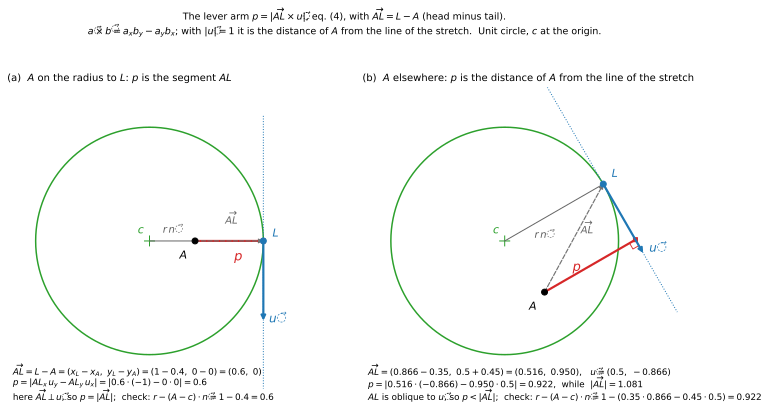

*Figure 11. The lever arm of eq. (4) on a unit circle with teaching values, centre $c$ at the origin. (a) The axle on the radius to $L$: the arm is the segment $AL$. (b) The axle elsewhere: the arm is the distance of $A$ from the line of the stretch, shorter than $|\overrightarrow{AL}|$. Each case is also computed with the form $p = r - (A - c)\cdot\vec n$ given below.*

The same arm in a form that shows why it changes: the line of the stretch is tangent to the circle at $L$, so it is at the distance $r$ from the centre; the axle is offset from the centre, and its distance from the line is $r$ corrected by the projection of the offset on the radius to $L$. In vectors, $\overrightarrow{AL} = r\,\vec n + (c - A)$, with $\vec n = (\cos\theta,\ \sin\theta)$ the unit vector of the radius to $L$, perpendicular to $\vec u$; the component perpendicular to $\vec u$ is $r - (A - c)\cdot\vec n$:

$$p = r - \big[(x_A - x_c)\cos\theta + (y_A - y_c)\sin\theta\big]$$

The bracket is at most $e$ in absolute value, so the arm lies between $r - e$ and $r + e$: short when the axle is offset towards the tangent point, long when it is offset away from it (figure 9).

### 5.1 Quantities

| Symbol | Meaning | Value | Source |
|---|---|---|---|
| $F_{pk}$ | peak draw force | 311 N (70 lb) | standard (ATA speed rating) |
| $DL$ | draw length | 762 mm (30 in) | standard (ATA) |
| $x_f$ | nocking point at full draw, $DL$ − 1.75 in | 717.55 mm | standard (definition of draw length) |
| $h_b$ | brace height | 177.8 mm (7 in) | assumed |
| $D_f$ | power stroke, $x_f - h_b$ | 539.75 mm (21.25 in) | derived |
| $m_a$ | arrow mass | 22.68 g (350 grains) | standard (ATA) |
| $m_v$ | virtual mass of the bow (§6.5) | 3.88 g | Park 2009 (measured on a compound bow); assumed for both bows |
| $y_H$ | height of the limb hinge | 250 mm | assumed |
| $\ell$ | length of the limb arm | 400 mm | assumed |
| $\alpha_b$ | limb angle at brace | 20° | assumed |
| $\alpha_b - \alpha_u$ | limb rotation from unstrung to brace (preload) | 25° | assumed, same for both bows |
| $e/r$ | eccentricity of the pulley | 0.70 | assumed (reference case); a control of the explorer |
| $\gamma$ | direction of the centre from the axle at brace | 180° | patent (long side towards the cable at rest) |
| $r$ | radius of the pulley | 29.5 mm | derived: valley at full draw, eq. (19) |
| $e$ | offset of the axle | 20.7 mm | derived, $e/r \cdot r$ |
| $C$ | rotational stiffness of the limb hinge, eccentric pulleys | 429 N·m/rad | derived: peak = $F_{pk}$, eq. (18) |
| $C_0$ | rotational stiffness of the limb hinge, string tied to the limbs | 109 N·m/rad | derived: peak = $F_{pk}$, eq. (18) |

With these values the bow measures about 1.25 m between the axles at brace, and the pulley is 59.1 mm across.

## 6. Derivation

The system has one degree of freedom: the string and the cable are inextensible, so a draw $D$ fixes the rotation $\psi$ of the pulley and the angle $\alpha$ of the limb. The draw force follows from the energy (§6.2) and, independently, from the equilibrium of the parts (§6.3); `check.py` verifies that the two agree.

For each rotation $\psi$ the model guesses $\alpha$, builds the axle, the centre and the tangent points with eq. (1)–(3), and corrects $\alpha$ until the cable has its length, eq. (6); eq. (5) then gives $x$. The loop is solved numerically. Once a point is solved ($\alpha$, $\psi$, $N$ known), eq. (1)–(4) and (9)–(12) can be followed by hand; §6.3 gives the numbers at full draw.

### 6.1 Length of string and cable

The string is fixed to the pulley at the crossover notch, so the length from the notch to the nocking point is constant: free length plus the length wrapped on the track. Turning the pulley by $\psi$ unwinds string and winds cable; the tangent points also move as the pulley and the limb move. With the wrapped lengths counted from brace:

$$t_s + r\cdot(-\psi - \theta_s) = S_s \tag{5}$$

$$t_c + r\cdot(\theta_c + \psi) = S_c \tag{6}$$

where $t_s, \theta_s$ come from eq. (3) with $Q = N$, $t_c, \theta_c$ with $Q = A'$, and the constants $S_s$, $S_c$ are their values at brace ($\psi = 0$, $\alpha = \alpha_b$, string straight). Eq. (6) contains only $\alpha$ and $\psi$: for each rotation of the pulley it gives the angle of the limb. Eq. (5) then gives the position $x$ of the nocking point. Both are solved numerically, step by step along $\psi$. Valid while the string is wrapped on its track: the patent wraps the string one and a half turns on the circular pulley, and the pulley turns 170° in the reference case.

For each draw $D$ the equations give one angle $\alpha(D)$ and one rotation $\psi(D)$; the force follows from $\alpha(D)$ (§6.2). The angle $\theta_c$ is followed continuously from brace: at full draw it is 180.45°, not the −179.55° that $\operatorname{atan2}$ returns; the second value makes the cable a turn shorter, $2\pi r$ = 185.6 mm.

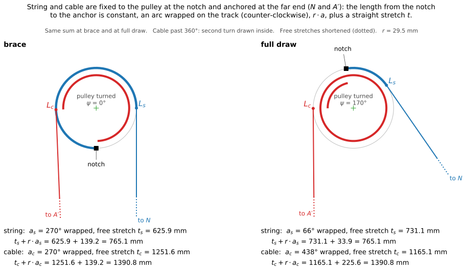

*Figure 12. String and cable at brace and at full draw. Each is fixed to the pulley at the notch and anchored at its far end ($N$ for the string, the lower axle $A'$ for the cable): an arc wrapped on its track, $r\cdot a$, plus a straight stretch $t$, with the same sum at brace and at full draw. The sums count the 270° wrapped at brace; eq. (5) and (6) count the wrap from the angles $\psi$ and $\theta$, so their constants $S_s$, $S_c$ differ from these sums by a fixed amount.*

At brace the string is straight and the length from notch to nocking point is at its minimum: the first millimetres of string unwound move the nocking point a long way, as when a taut rope is pulled sideways. The draw force starts from zero (figure 16).

### 6.2 Draw force from the energy

The two limbs store the elastic energy

$$U = 2 \cdot \tfrac12\,C\cdot(\alpha - \alpha_u)^2 = C\cdot(\alpha-\alpha_u)^2 \tag{7}$$

String and cable do no work (inextensible), the pulley turns without friction, and the process is slow: the work of the archer equals the change of $U$. $U$ depends on the draw only through the angle of the limb, $\alpha(D)$, so by the chain rule

$$F = \frac{dU}{dD} = \frac{dU}{d\alpha}\,\frac{d\alpha}{dD}, \qquad \frac{dU}{d\alpha} = 2\,C\cdot(\alpha-\alpha_u)$$

$$F = 2\,C\cdot(\alpha - \alpha_u)\,\frac{d\alpha}{dD} \tag{8}$$

valid in quasi-static conditions. Here $D = x - h_b$ is the draw from brace, so $dD = dx$ ($h_b$ constant). $C$ is fixed in §7.1 so that the peak of $F$ equals $F_{pk}$: the shape of the curve does not depend on it. The geometry enters only through $d\alpha/dD$, the rotation of the limb per unit draw: the pulley makes it large at the start of the draw and small at the end. Eq. (8) is evaluated by numerical differentiation along the solution of §6.1.

### 6.3 Draw force from the equilibrium

**Pulley.** The pulley carries the string tension $T_s$ and the cable tension $T_c$ and turns freely on the axle. Its moments about the axle balance:

$$T_s\,p_s = T_c\,p_c \quad\Rightarrow\quad k = \frac{T_c}{T_s} = \frac{p_s}{p_c} \tag{9}$$

valid without friction on the axle. The force of the pulley on the axle, and so on the limb, is $T_s\vec u_s + T_c\vec u_c$, with $\vec u_s$ the unit vector of the string from $L_s$ towards $N$ and $\vec u_c$ that of the cable from $L_c$ towards $A'$.

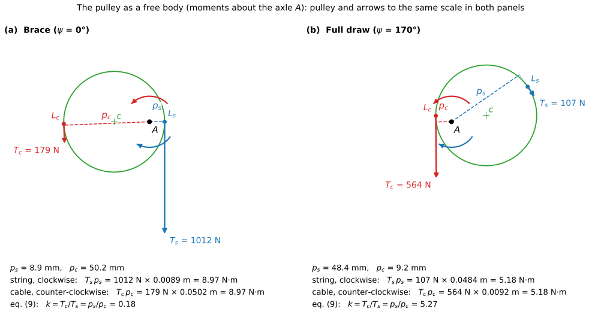

*Figure 13. The pulley as a free body at brace and at full draw; pulley and arrows to one scale in both panels. The string tension $T_s$ acts at $L_s$, the cable tension $T_c$ at $L_c$; their lever arms about the axle are dashed. The two moments balance, eq. (9). At brace the string carries 1012 N and the cable 179 N ($k$ = 0.18); at full draw the string 107 N and the cable 564 N ($k$ = 5.27). The force of the axle on the pulley has no moment about $A$ and is not drawn.*

**Limb.** The limb also carries, at its axle, the cable of the lower pulley, with the same tension $T_c$ by symmetry, along the unit vector $\vec u_c'$ from $A$ towards the lower tangent point. Moments about the hinge $H$ (clockwise negative; the elastic moment opposes the growth of $\alpha$):

$$C\cdot(\alpha - \alpha_u) = -\,\vec\ell \times \big(T_s\vec u_s + T_c\vec u_c + T_c\vec u_c'\big) \tag{10}$$

Both sides are moments about $H$, in N·m: on the left the elastic moment of the hinge, on the right the moment of the three tensions at the axle. That is, in coordinates, with $R_x$, $R_y$ the components of the sum $\vec R$ of the three tensions acting at the axle:

$$
\begin{aligned}
C\cdot(\alpha-\alpha_u) &= -\big[(x_A - x_H)\,R_y - (y_A - y_H)\,R_x\big]\\
R_x &= T_s\,u_{s,x} + T_c\,(u_{c,x} + u'_{c,x})\\
R_y &= T_s\,u_{s,y} + T_c\,(u_{c,y} + u'_{c,y})
\end{aligned}
$$

The two cables are mirror images: $\vec u_c$ and $\vec u_c'$ have opposite $x$ components and equal $y$ components, so $\vec u_c + \vec u_c' = (0,\ 2u_{c,y})$.

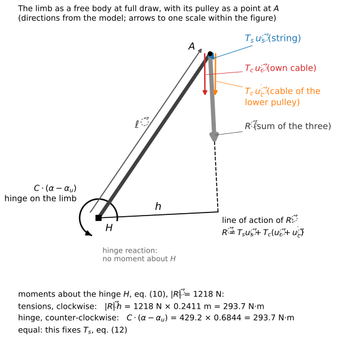

*Figure 14. The limb as a free body at full draw, with its pulley reduced to the point $A$ (directions from the model; arrows to one scale within the figure): the three tensions at the axle and their sum $\vec R$, the arm $h$ of $\vec R$ about the hinge, the elastic moment of the hinge on the limb. The hinge reaction has no moment about $H$. The two moments are equal, 293.7 N·m.*

**Nocking point.** The two halves of the string pull the nocking point with $T_s$ each; the archer balances their $x$ components:

$$F = 2\,T_s\,u_{s,x} \tag{11}$$

**Together.** With $T_c = k\,T_s$ from eq. (9), the three tensions at the axle become

$$T_s\vec u_s + T_c\vec u_c + T_c\vec u_c' = T_s\,\vec w, \qquad \vec w = \vec u_s + k\,(\vec u_c + \vec u_c')$$

$\vec w$ is the force at the axle per newton of string tension. The two cables are mirror images, so their $x$ components cancel and their $y$ components add:

$$w_x = u_{s,x}, \qquad w_y = u_{s,y} + 2k\,u_{c,y}$$

$T_s$ is a common factor and comes out of eq. (10):

$$C\cdot(\alpha-\alpha_u) = -\,T_s\,M, \qquad M = \vec\ell \times \vec w = \ell_x\,w_y - \ell_y\,w_x$$

$$T_s = \frac{-\,C\cdot(\alpha-\alpha_u)}{M} \tag{12}$$

$M$ is the moment about $H$ of the forces at the axle per newton of string tension, in metres (N·m per N). With $T_s$, eq. (11) gives the draw force. At full draw: $\vec w$ = (0.5688, −11.371); $\vec\ell$ = (0.2249, 0.3308) m; $M$ = 0.2249 · (−11.371) − 0.3308 · 0.5688 = −2.7455 m; $T_s$ = −429.2 · 0.6844 / (−2.7455) = 107.0 N; $F$ = 2 · 107.0 · 0.5688 = 121.7 N, the holding force.

Eq. (12) is valid with the same assumptions as eq. (8). The two roads, eq. (8) and eq. (12), use different relations (lengths and energy; moments); along the whole draw of the reference case they differ by at most 0.13 N, the error of the numerical derivative.

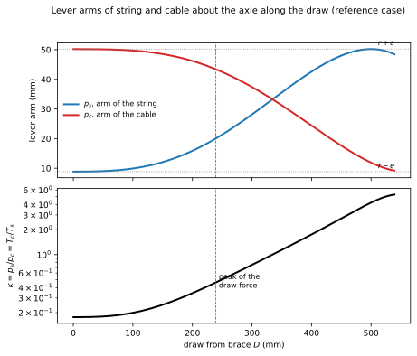

*Figure 15. Lever arms of string and cable about the axle along the draw, reference case, and their ratio $k$ (logarithmic scale). The peak of the draw force is marked.*

**Why the force falls.** At brace $p_s$ = 8.9 mm and $p_c$ = 50.2 mm, $k$ = 0.18: the string pulls on a short arm and the cable on a long one. At full draw $p_s$ = 48.4 mm and $p_c$ = 9.2 mm, $k$ = 5.27: the cable carries 5.27 times the tension of the string (figures 13 and 15). The limbs, bent further, pull harder on the cables, but the pulley now turns that pull into a small string tension: at full draw $T_c$ = 564.3 N and $T_s$ = 107.0 N.

### 6.4 The bow with the string tied to the limbs

The comparison bow is the known way: the same limb (arm length $\ell$, hinge height $y_H$, angles $\alpha_b$ and $\alpha_u$) and the same brace height, with the string fastened at the axles and no pulleys. Its hinge stiffness $C_0$ is set, like $C$, so that its peak force is $F_{pk}$ (§7.1): the two bows peak alike and differ in how the force rises. A second setting of $C_0$, for the same stored energy, is used in §6.5 and §7.3.

At brace the string is straight between the axles, with half length $s_0 = y_A(\alpha_b)$. During the draw the string keeps its length:

$$(x - x_A)^2 + y_A^2 = s_0^2 \tag{13}$$

which gives the position $x$ of the nocking point for each $\alpha$. With $\vec u$ the unit vector from $A$ to $N$, the equilibrium of the limb, as in eq. (10) but with one tension only, gives the string tension $T$:

$$C_0\cdot(\alpha-\alpha_u) = -\,T\;\vec\ell\times\vec u \tag{14}$$

that is, in coordinates, $C_0\cdot(\alpha-\alpha_u) = -\,T\,[(x_A - x_H)\,u_y - (y_A - y_H)\,u_x]$. The draw force is $F = 2\,T\,u_x$, as in eq. (11). It grows along the whole draw (figure 16).

### 6.5 Energy and arrow speed

*Figure 16. Draw force along the draw from brace, both bows with the peak of 311 N and the same draw. The shaded areas are the stored energies; the dashed rectangle is the largest energy any bow with this peak and this draw can store.*

**Stored energy.** The work done between brace and full draw is the area under the force–draw curve, and it equals the change of the elastic energy, eq. (7):

$$E = \int_0^{D_f} F\,dD = C\cdot\big[(\alpha_f - \alpha_u)^2 - (\alpha_b - \alpha_u)^2\big] \tag{15}$$

with $\alpha_f$ the limb angle at full draw. No bow can store more than the rectangle of peak force and stroke:

$$E \le F_{pk}\,D_f \tag{16}$$

The bound follows from eq. (15) and S1: along the whole stroke the force never exceeds the peak, $F(D) \le F_{pk}$, so the area under the curve cannot exceed the area of the rectangle of height $F_{pk}$ and base $D_f$. The rectangle is the ideal bow: its force would jump to the peak in the first millimetre of draw and stay there up to full draw. No real bow reaches it, because at brace the force starts from zero. Here it is 168.1 J, dashed in figure 16. The fraction of the rectangle a bow fills, $\eta = E/(F_{pk}\,D_f)$, measures how full its curve is: a force that rose linearly from zero would give $\eta$ = 0.50.

**Arrow speed.** After the release, the limbs, the pulleys and the string move with the arrow and keep part of the energy. A simple and common way to account for it (Klopsteg; Hickman; Park 2009) is a virtual mass $m_v$ of the bow, which moves with the arrow and receives its share of the energy:

$$\tfrac12\,(m_a + m_v)\,v^2 = E \quad\Rightarrow\quad v = \sqrt{\frac{2E}{m_a + m_v}} \tag{17}$$

valid when the virtual mass is a constant of the bow, measured by shooting arrows of different mass (Park 2009, 3.88 g). The model uses the same virtual mass for both bows; §10 says how much this matters.

Eq. (17) depends on the bow only through $E$ and $m_v$, not on the shape of the force–draw curve: two bows that store the same energy, with the same virtual mass, give the arrow the same speed. Equal areas under the curves mean equal arrow speeds (figure 17).

*Figure 17. The two bows at full draw for the same stored energy, 119.3 J, and so the same arrow speed, 94.8 m/s with 350 grains (eq. (17), same virtual mass). Top: drawn to scale, with the force the archer holds at the nocking point $N$ (arrows to one scale). Bottom: the force–draw curves; the shaded areas are equal. The bow with the string tied to the limbs has here $C_0$ = 161 N·m/rad instead of 109 (§7.3).*

## 7. Conditions and setting

### 7.1 Setting

**Stiffness of the limbs (S1).** For a given geometry, the draw force of eq. (8) is proportional to $C$. The stiffness is chosen so that the largest force along the draw equals the peak force of the reference case:

$$\max_{0 \le D \le D_f} F(D) = F_{pk} \tag{18}$$

for each bow: $C$ = 429 N·m/rad with eccentric pulleys, $C_0$ = 109 N·m/rad with the string tied to the limbs. The bow with eccentric pulleys needs limbs 3.9 times stiffer at equal peak, 2.7 times at equal stored energy (§7.3); the patent prefers limbs "approximately three times the strength of conventional bow limbs" and does not say on which basis it compares.

**Radius of the pulley (valley at full draw).** The radius sets how far the pulley turns over the draw: a smaller pulley turns more. It is chosen so that the lowest force after the peak, the valley, falls exactly at full draw:

$$\left.\frac{dF}{dD}\right|_{D_f} = 0,\qquad F(D_f) = \min_{D > D_{pk}} F \tag{19}$$

which gives $r$ = 29.5 mm for $e/r$ = 0.70. Drawing beyond the valley, the force rises again: the archer feels where full draw is. The bow is set for one draw length; §8 shows what happens to an archer with another.

### 7.2 Conditions

**C1 (S2), let-off of at least 50 %** (let-off = 1 − holding force / peak force):

$$F(D_f) \le 0.5\,F_{pk} \tag{20}$$

**C2 (S3), more energy than the bow with the string tied to the limbs:**

$$E \ge E_0 \tag{21}$$

**C3 (S4), the bow returns the string:**

$$F(D_f) > 0 \tag{22}$$

C3 holds for every eccentricity $e < r$: the cable arm $p_c$ never vanishes, so eq. (9) always leaves the string a positive tension.

### 7.3 The reference case

With $e/r$ = 0.70 the two bows compare as follows; the third column is the bow with the string tied to the limbs set for the same stored energy instead of the same peak.

| | eccentric pulleys | string tied, same peak | string tied, same energy |
|---|---|---|---|
| hinge stiffness | 429 N·m/rad | 109 N·m/rad | 161 N·m/rad |
| peak draw force | 311 N (70 lb), at 239 mm of draw | 311 N (70 lb), at full draw | 459 N (103 lb), at full draw |
| force held at full draw | 122 N (27.4 lb) | 311 N (70 lb) | 459 N (103 lb) |
| let-off | 61 % | 0 % | 0 % |
| stored energy | 119.3 J (88.0 ft·lb) | 81.0 J (59.7 ft·lb) | 119.3 J (88.0 ft·lb) |
| fill of the rectangle, $\eta$ | 0.71 | 0.48 | 0.48 |
| arrow speed, 350 grains | 94.8 m/s (311 ft/s) | 78.1 m/s (256 ft/s) | 94.8 m/s (311 ft/s) |

For the same peak and draw, the bow with eccentric pulleys stores 47 % more energy than the bow with the string tied to the limbs (C2) and, with the virtual mass of 3.88 g, sends the arrow 21 % faster; at full draw the archer holds less than half the peak, let-off 61 % (C1).

**For the same arrow speed.** Set for the same stored energy (figure 17), the bow with the string tied to the limbs needs limbs of 161 N·m/rad and peaks at 459 N (103 lb), which the archer holds at full draw: 3.8 times the 122 N of the bow with eccentric pulleys.

The limbs work differently. With eccentric pulleys they turn 14.2° from brace to full draw (the axle travels 99 mm), with the string tied to them 30.3° (211 mm): stiffer limbs that move less, as the patent states. And the draw starts much harder: after 50 mm of draw the force is 130 N against 42 N.

## 8. Domain

The reference case is one bow. This section asks how the result changes with the two quantities that vary in practice: the eccentricity, chosen by the maker, and the draw length, set by the archer. On that plane it shows where the bow does its job: the archer holds at most half the peak force at full draw (C1), the bow stores more energy than the bow with the string tied to the limbs (C2), and the string stays taut at full draw, so the bow returns it (C3).

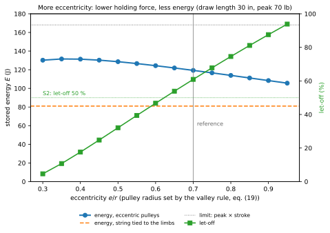

*Figure 18. Stored energy and let-off against the eccentricity, at the draw length of the setting (30 in); the radius of the pulley is set by eq. (19) for each eccentricity. Let-off = 1 − holding force / peak force (S2).*

The eccentricity $e/r$ is the parameter of the idea: with $e = 0$ the pulley is a plain wheel and the arms of string and cable are equal. Increasing it lowers the holding force and the stored energy together (figure 18): from $e/r$ = 0.30 to 0.95 the let-off goes from 5 % to 94 % and the energy from 130.2 J to 105.6 J. At every eccentricity the energy stays above that of the bow with the string tied to the limbs (81.0 J). Below $e/r$ = 0.30 the force has no valley before the pulley completes a turn, and eq. (19) has no solution.

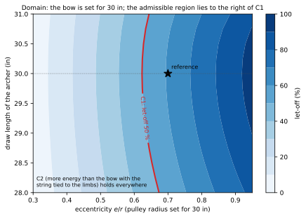

*Figure 19. Domain in the plane eccentricity × draw length of the archer. The bow is set (eq. (18), (19)) for 30 in at each eccentricity; an archer with another draw length holds it before or past the valley. Colour: let-off; red line: let-off of 50 % (C1).*

The second parameter is the draw length of the archer, because the bow is set for one (figure 19). An archer who draws less holds the bow before the valley, where the force is higher; one who draws more holds it past the valley, where the force rises again. With the reference bow the let-off is 53 % at 28 in and 57 % at 31 in, against 61 % at 30 in. The let-off of 50 % (C1) closes the domain on the left: the smallest eccentricity that gives 50 % of let-off is about 0.62 at 30 in and 0.67 at 28 in. The energy stays above that of the bow with the string tied to the limbs (C2) and the string stays taut (C3) over the whole plane; on the right the plane ends where the axle reaches the rim of the pulley ($e/r$ = 1). The energy over the plane stays between 1.29 and 1.68 times that of the bow with the string tied to the limbs.

## 9. Explorer

- **Controls:** eccentricity $e/r$, 0.30–0.95, default 0.70; draw length of the archer, 28–31 in, default 30 in; arrow mass, 250–500 grains, default 350 grains. The radius of the pulley is set by eq. (19) for 30 in and shown.
- **Outputs:** draw force along the draw for both bows, with the current point; stored energies and their ratio; holding force and let-off; arrow speeds; rotation of the pulley; tensions of string and cable.
- **Conditions shown true/false:** let-off of at least 50 % (C1), more energy than the bow with the string tied to the limbs (C2), string taut at full draw (C3).
- **Diagrams:** the bow drawn to scale that follows a draw slider, with the pulleys turning and the lever arms $p_s$ and $p_c$ drawn; the force–draw curves of figure 16 with the point of the slider; the lever arms of figure 15.

## 10. What it allows and where it stops

In the reference case the eccentric pulleys let a bow with a peak of 311 N (70 lb) store 119.3 J instead of 81.0 J and send a 350-grain arrow at 94.8 m/s instead of 78.1 m/s, while the archer holds 122 N instead of 311 N at full draw. Both gains come from one mechanism: the pulley changes, along the draw, the ratio between the string unwound and the cable wound, eq. (9). Early in the draw the limbs bend fast and the force climbs to the peak; late in the draw they bend slowly and the force falls. Seen the other way, for the same arrow speed the bow with the string tied to the limbs needs limbs of 161 N·m/rad and the archer holds 459 N (103 lb) at full draw: 3.8 times the 122 N of the bow with eccentric pulleys (§7.3).

The gain has a ceiling and a price. The ceiling is the rectangle of eq. (16), 168.1 J: no profile of the pulley can store more with this peak and this draw. The price is that holding force and stored energy cannot both be pushed: more eccentricity means less force at full draw and less energy (figure 18), because the force drops earlier and the area under the curve shrinks. And the bow works for one draw length: it must be set for the archer, through the radius of the pulley (eq. (19)), and the let-off falls by several points for an inch of difference (§8). The conventional bow has neither limit: it can be drawn to any length, and it holds at full draw whatever it peaks at.

The model leaves out several things; each changes the numbers, none reverses the conclusions:

- **Limb.** The limb is a rigid arm on an elastic hinge, not a beam bending along its length; this changes the shape of the force curves somewhat, but both bows share it and the comparison does not depend on it.
- **Stretch of string and cable.** String and cable are inextensible: a stretching string stores and loses some energy and lowers both curves; the conclusions keep their sign.
- **Thickness of the cable.** String and cable are also lines without thickness. Past one turn of the cable on its track, after 370 mm of draw with the pulley turned 91°, the cable winds over itself (438° at full draw, §4.4): it leaves the pulley from a radius larger by its diameter, and its arm grows by as much. With a cable of 1.6 mm (1/16 in, assumed) and the same limbs, the holding force rises from 122 N to 140 N, a let-off of 55 % instead of 61 %; the peak does not change, and the archer still holds less than half the peak (C1).
- **Friction.** The pulley turns without friction: with a pin of 3 mm radius and a friction coefficient of 0.10, the friction moment at full draw is 3.8 % of the moment of the cable about the axle, so the holding force would be a few percent higher when drawing and lower when letting down; the let-off stays above 50 % (C1).
- **Masses.** The model is quasi-static and is not meant for the dynamics of the shot: the arrow speed rests on the virtual mass, taken from a modern compound bow (Park 2009) and assumed equal for both bows. The pulleys add mass at the limb tips, as the patent admits, and a heavier virtual mass lowers the speed; the bow with eccentric pulleys would lose its speed advantage only with a virtual mass of 16.4 g, four times the value used.
- **After the release.** What happens after the release — the share of energy between limbs, pulleys and arrow, the peak of acceleration of the arrow just before it leaves the string, the time the string spends near the archer's face — needs a dynamic model with the masses and inertias of the parts; Park (2009) gives one.
- **The arrow.** The arrow itself bends and vibrates as it leaves the bow (the archer's paradox; Kooi and Sparenberg 1997, Park 2011): this is outside the model, and it does not change the energy given to the arrow.

## References

- H. W. Allen, US 3,486,495, *Archery bow with draw force multiplying attachments*, filed 23 June 1966, granted 30 December 1969.
- J. L. Park, "A compound archery bow dynamic model, suggesting modifications to improve accuracy", *Proc. IMechE Part P: J. Sports Engineering and Technology* 223 (2009) 139–150, doi 10.1243/17543371JSET48.
- J. L. Park, "The behaviour of an arrow shot from a compound archery bow", *Proc. IMechE Part P* 225 (2011) 8–21, doi 10.1177/17543371JSET82.
- B. W. Kooi, J. A. Sparenberg, "On the mechanics of the arrow: archer's paradox", *J. Engineering Mathematics* 31 (1997).
- C. N. Hickman, "Dynamics of a bow and arrow", *J. Applied Physics* 8 (1937).

