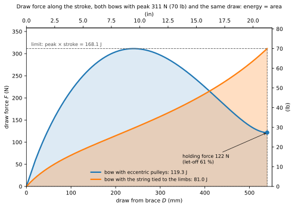
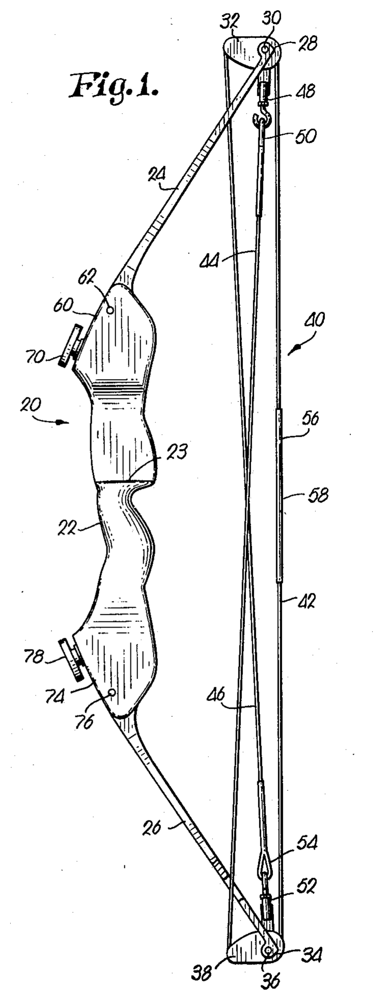
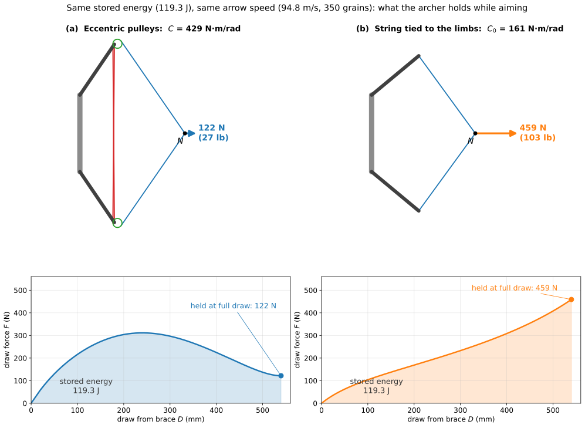

An archer draws the string with one hand, holds it against the face, aims, and only then lets go. For the whole time of the aim the fingers carry the force of the bow at full draw. Manufacturers rate the speed of compound bows at a peak draw force of 70 lb, 311 N, about the weight of a 32 kg mass: in a bow whose force keeps rising, that is what the archer would hold still while the eye settles on the target.

## The function and the known way

A bow stores in its limbs the work the archer does in drawing the string, and gives it back to the arrow when the string is released. Two quantities matter to the archer. The first is the energy stored at full draw, which sets the speed of the arrow. The second is the force held at full draw, which is what the archer bears while aiming. The draw length is not free: it is fixed by the archer's body, and the speed rating takes 30 in (762 mm). So the only way to store more energy is to draw harder.

The known way is the bow with the string tied to the limb tips, the longbow and the recurve. Its draw force grows along the whole draw: each centimetre bends the limbs further, and the limbs push back harder. The peak of the force is reached at full draw, which is exactly where the archer holds it while aiming. The stored energy is the area under the force–draw curve, and a curve that starts from zero and climbs to its peak at the end fills less than half of the rectangle of peak force and stroke: here 0.48. With a peak of 311 N and the standard draw, such a bow stores 81.0 J (59.7 ft·lb) and sends a 350-grain arrow at 78.1 m/s (256 ft/s).

The contradiction sits in the shape of that curve. More energy means more area; more area, with a curve of this shape, means a higher peak; and the higher peak is what the archer has to hold steady while aiming. The patent says it in its own terms: in the conventional bow the force rises up to full draw, and the archer holds it while aiming, which limits the energy a bow can store for a given draw.

*Draw force along the draw from brace, for the bow with eccentric pulleys and the bow with the string tied to the limbs, both with the peak of 311 N and the same draw. The shaded areas are the stored energies; the dashed rectangle is the largest energy any bow with this peak and this draw can store. Figure 16 of the model page.*

## The idea

US 3,486,495 (H. W. Allen, priority 1966) changes the shape of the curve. At each limb tip it mounts an eccentric pulley, turning on an axle placed off its centre, and it reroutes the bowstring: the string the archer pulls runs from pulley to pulley, and from each pulley a cable runs to the axle of the opposite limb. Drawing the string unwinds it from one track of the pulley and turns the pulley; the same rotation winds the cable on the other track, and the cable pulls the limb tips towards each other.

The eccentric axle makes the pulley change, along the draw, the ratio between the string unwound and the cable wound. Early in the draw the cable winds on a long arm and the string leaves from a short one: a little string bends the limbs a lot, and the force climbs fast. Late in the draw the arms have exchanged: the string works on the long arm and the cable on the short one, and the load of the limbs reaches the archer reduced. The force rises early, peaks part-way, and falls into a valley at full draw.

*The bow of US 3,486,495, figure 1 of the patent (H. W. Allen, 1966), strung and at rest: the eccentric pulleys 32 and 38 at the limb tips, the bowstring 40 with its central stretch 42 and the end stretches 44 and 46 crossing to the opposite limbs.*

## Why it works

The pulley is a lever whose arms change with its rotation. String and cable leave the pulley on opposite sides of the axle, so the offset that shortens the arm of one lengthens the arm of the other. Turning the pulley without friction, the two tensions balance through their arms: the string tension times its arm equals the cable tension times its arm.

At brace, in the reference case, the arm of the string is 8.9 mm and that of the cable 50.2 mm: the string pulls on a short arm, and a small rotation of the pulley winds a lot of cable. The limbs bend fast for each millimetre of draw, and the force climbs. The force reaches its peak after 239 mm of draw, with the pulley turned 46°. At full draw the pulley has turned 170° and the arms have exchanged: 48.4 mm for the string, 9.2 mm for the cable. The limbs, bent further, pull harder on the cables, 564 N, but the pulley turns that pull into a string tension of 107 N. The archer holds 122 N (27.4 lb) instead of 311 N: a let-off of 61 %, the fraction of the peak spared while aiming.

*The upper pulley of the reference case in four phases of the draw: brace, peak of the force, arms equal, full draw; below, the whole bow in the same phase, to scale. The arms of string and cable are dimensioned in mm. Figure 4 of the model page.*

The same shape gives more energy. The force rises early and stays high over most of the stroke, so the curve fills 0.71 of the rectangle of peak force and stroke instead of 0.48. With the same peak of 311 N and the same draw, the bow with eccentric pulleys stores 119.3 J (88.0 ft·lb), 47 % more than the bow with the string tied to the limbs, and sends the 350-grain arrow at 94.8 m/s (311 ft/s), 21 % faster.

Seen the other way, the comparison is even plainer. The speed of the arrow depends on the energy stored, not on the shape of the curve. A bow with the string tied to the limbs can send the arrow just as fast if its limbs are made stiff enough to store the same 119.3 J: it then peaks at 459 N (103 lb) at full draw, and the archer must hold all of it while aiming. For the same arrow speed, the archer of the conventional bow holds 3.8 times the 122 N of the bow with eccentric pulleys.

*The two bows at full draw for the same stored energy, 119.3 J, and so the same arrow speed. Top: drawn to scale, with the force the archer holds at the nocking point. Bottom: the force–draw curves; the shaded areas are equal. Figure 17 of the model page.*

The price is paid in the limbs. To reach the same peak, the bow with eccentric pulleys needs limbs 3.9 times stiffer; the patent asks for limbs about three times as strong as conventional ones. Stiffer limbs that move less: from brace to full draw they turn 14.2°, against 30.3° for the limbs of the bow with the string tied to them.

## Where it stops

The gain has a ceiling. No profile of pulley can store more than the rectangle of peak force and stroke, 168.1 J in the reference case: the force would have to jump to the peak in the first millimetre of draw and stay there to the end, while a real bow starts from zero at brace.

Holding force and stored energy cannot both be pushed. The eccentricity of the pulley, the distance of the axle from its centre as a fraction of the radius, is the parameter of the idea. More eccentricity drops the force earlier and deeper: across the range of the model the let-off goes from 5 % to 94 %, but the energy falls from 130.2 J to 105.6 J, because the area under the curve shrinks. At every eccentricity the bow still stores more than the bow with the string tied to the limbs; the archer holds at most half the peak only above an eccentricity of about 0.62.

The bow works for one draw length. The valley is placed at full draw by the radius of the pulley, so the bow must be set for its archer. An archer who draws less holds the bow before the valley, where the force is higher; one who draws more holds it past the valley, where the force rises again. With the reference bow the let-off is 53 % at 28 in and 57 % at 31 in, against 61 % at 30 in. The bow with the string tied to the limbs has neither limit: it can be drawn to any length, and it holds at full draw whatever it peaks at.

The model behind these numbers is quasi-static and is not meant for the dynamics of the shot. It treats the limbs as rigid arms on elastic hinges, string and cable as inextensible lines, and the pulley as free of friction; each of these changes the numbers, and none reverses the comparison: a cable of 1.6 mm winding over itself, for instance, raises the holding force from 122 N to 140 N, and the let-off stays above half. The arrow speed rests on a virtual mass of the bow taken from a modern compound bow: the pulleys add mass at the limb tips, as the patent admits, but the advantage in speed would vanish only with a virtual mass four times the one used. What happens after the release, and the bending of the arrow as it leaves the string, are outside the model.

## The same principle elsewhere

A pulley whose arm changes along its rotation, to shape a force that would otherwise rise or fall, is older than the bow. The fusee of spring-driven clocks, from the fifteenth century, is a cone on which a chain from the mainspring barrel winds: when the spring is fully wound and strongest, the chain pulls on the narrow end of the cone; as the spring runs down, the chain moves to the wide end, and the longer arm compensates the falling force, so the clock is driven with a nearly constant torque.

In the strength-training machines introduced by Nautilus in 1970, a cam shaped like a nautilus shell sits between the weight stack and the lever the athlete moves. The varying radius of the cam changes the resistance along the movement, so that it follows the way the strength of the muscle changes with the angle of the joint. The compound bow does the opposite with the same means: it makes the force high where the archer can deliver it and low where the archer has to hold it.

## Further reading

The mechanism, with the model, its assumptions and every number of this page, is on [the model page](../math/). The [explorer](/calculators/c2_compound_bow_explorer.html) draws the bow through the whole draw, with the pulleys turning and the lever arms of string and cable, and lets you change the eccentricity, the draw length of the archer and the arrow mass, and compare the bow with the string tied to the limbs at the same peak or at the same arrow speed. The other ways of performing the same function, before and after this patent, are on the [entry page](../). For the dynamics of the shot and the behaviour of the arrow, J. L. Park (2009, 2011) gives a dynamic model of a modern compound bow and measurements.

**Sources.** US 3,486,495 (Google Patents). J. L. Park, "A compound archery bow dynamic model, suggesting modifications to improve accuracy", *Proc. IMechE Part P* 223 (2009) 139–150; J. L. Park, "The behaviour of an arrow shot from a compound archery bow", *Proc. IMechE Part P* 225 (2011) 8–21. Fusee: Barrington Watch Winders, "Fusee and chain". Nautilus: Core Health & Fitness, "The first name in strength".
